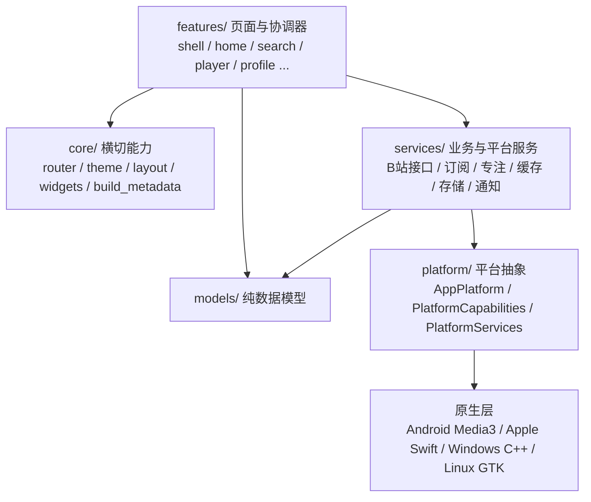

# 02 · 整体架构与启动流程

## 2.1 分层架构

FocuBili 采用“单一 Dart 业务层 + 多原生 Runner”的单仓库结构。Dart 层按职责分为五层，依赖方向只能自上而下：

关键约束：

- **页面不直接判断操作系统**。所有平台差异通过 `PlatformCapabilities` 表达，具体实现由 `PlatformServices` 装配。
- **`models/` 不依赖 Flutter UI**（个别模型带 `ChangeNotifier` 的控制器除外）；便于纯 Dart 单测。
- **服务优先注入**。播放器页面、根组件都接受可选服务参数，测试用内存/假实现替换，不在内部直接构造原生对象。
- **降级优先于崩溃**。不支持的平台返回 `_Unavailable*` 实现或稳定错误状态，而不是抛异常或调用缺失通道。

## 2.2 启动流程（`main` → 首帧）

入口 [lib/main.dart](../../lib/main.dart) 的 `main()` 按以下顺序执行：

1. `WidgetsFlutterBinding.ensureInitialized()`。
2. **WebView2 子进程短路**：`runWebViewTitleBarWidget(args)` 为真时直接返回，避免桌面 WebView 标题栏子进程重复启动整个应用。
3. `_installProblemDiagnostics()`：接管 `FlutterError.onError` 与 `PlatformDispatcher.onError`，只记录固定操作名 + 异常 `runtimeType`，不记录正文/堆栈。
4. `AppLayoutPreferencesService().initialize()`：布局偏好只在启动时载入（设置页提示重启生效）。
5. iOS 首次方向设置：按逻辑尺寸调用 `DeviceOrientationPolicy.startupOrientations()`。
6. `CacheLifecycle.initialize()`：建立字幕/账号缓存失效栅栏。
7. `ImageResourceCache.cleanLegacyCache()` 与 `status()`（不阻塞启动）。
8. 桌面媒体缓存维护：`WindowsMediaCacheService().maintain()`（mediaKit 缓存平台）。
9. `_prepareWindowsDesktop()`：
   - `PlaybackBackendKind.mediaKit` → `MediaKit.ensureInitialized()`、`AppleVideoCapabilities.initialize()`；
   - `supportsDesktopWindow` → `window_manager.ensureInitialized()`、按屏幕计算初始/最小尺寸、居中显示；
   - Linux 额外设置 `LinuxMiniPlayer.normalMinimumSize` 并探测 Linux 通知可用性。
10. `SubscriptionService.instance.initialize()` 与 `reconcileBackgroundSchedule()`：恢复订阅开关与原生后台调度；失败不阻塞启动。
11. `SystemChrome.setEnabledSystemUIMode(edgeToEdge)` 与首帧浅色系统栏样式。
12. `runApp(const FocuBiliApp(checkForUpdatesOnStart: true))`。

> Android 的启动方向由 `MainActivity` 在 Flutter 首帧前决定，避免未稳定窗口尺寸把平板误判为手机。

## 2.3 根组件与全局状态

[lib/app.dart](../../lib/app.dart) 的 `FocuBiliApp` / `_FocuBiliAppState` 持有全应用唯一实例：

| 成员 | 作用 | 所有权 |
|---|---|---|
| `FocusTimerController` | 唯一专注计时状态；跨页面共享 | 默认自建，测试可注入 |
| `AppUpdateController` | 启动检查与“关于”页更新状态 | 默认自建 |
| `AppThemeModeController` | 主题模式与种子色 | 默认自建 |
| `AppTextScaleController` | 80%–200% 文字缩放 | 默认自建 |
| `BilibiliDeepLinkService` | Android 冷启动/运行期深链 | 自建 |
| `WindowsClipboardLinkMonitor` | 前台剪贴板 B 站链接检测 | 自建 |
| `BilibiliService` | 深链解析后的视频详情查询 | 默认 `BilibiliVideoInfoService` |
| `SubscriptionService` | 订阅数据与通知回调接线 | 默认静态单例 |
| `SubscriptionNotificationService` | 通知初始化与点击处理 | 自建 |

装配要点：

- 订阅服务注入三个回调：`suppressNotifications`（专注中抑制通知）、`notifySummary`、`notifyItems`。
- 通知点击 `_handleSubscriptionTap()` 在首启协议通过前暂存，之后打开 `SubscriptionUpdatesPage`。
- 深链/剪贴板统一走 `BilibiliIncomingLinkResolver` → `lookupVideo` → 新建 `PlayerPage`；先 `PlayerRouteSession.suspendCurrent()`，返回后再恢复原播放器。
- 专注完成弹窗由 `_handleFocusTimerChanged()` 触发，同一 `session.id` 只弹一次。
- `dispose()` 只释放自己创建的控制器；注入实例由调用方负责。

`MaterialApp` 配置：

- `locale: zh_CN`，`GlobalMaterialLocalizations`；
- `theme/darkTheme: AppTheme.light/dark(seedColor)`；
- `home: FirstLaunchGate(child: MainShell())`；
- `onGenerateRoute: AppRouter.onGenerateRoute`；
- `builder` 依次包裹 `AppTextScale` → `AppThemeModeScope` → `AppUpdateScope` → `FocusTimerScope` → `AnnotatedRegion<SystemUiOverlayStyle>`。

## 2.4 路由与页面导航

[app_router.dart](../../lib/core/router/app_router.dart) 是唯一命名路由入口：

| 常量 | 路径 | 页面 |
|---|---|---|
| `AppRoutes.home` | `/` | `MainShell` |
| `AppRoutes.player` | `/player` | `PlayerPage`（参数 `VideoPreview`，缺失时用 `placeholder`） |
| `AppRoutes.login` | `/login` | `LoginPage` |
| `AppRoutes.cacheManagement` | `/settings/cache` | `CacheManagementPage` |
| `AppRoutes.about` | `/settings/about` | `AboutPage` |
| `AppRoutes.problemDiagnostics` | `/settings/about/diagnostics` | `ProblemDiagnosticsPage` |
| `AppRoutes.systemCapabilities` | `/settings/permissions` | `SystemCapabilitiesPage` |
| `AppRoutes.personalizationSettings` | `/settings/personalization` | `PersonalizationSettingsPage` |
| `AppRoutes.watchHistory` | `/history` | `WatchHistoryPage` |
| `AppRoutes.videoNotes` | `/notes` | `VideoNotesPage` |
| `AppRoutes.focusStatistics` | `/focus/statistics` | `FocusStatisticsPage` |

未知路由回退到 `MainShell`，避免空白页。多数详情页（UP 主、合集、订阅更新等）通过 `Navigator.push(MaterialPageRoute(...))` 直接构造，不注册命名路由。

## 2.5 主框架（`MainShell`）

[main_shell.dart](../../lib/features/shell/main_shell.dart)：

- 三个常驻页面：首页、搜索、“我的”，放在 `Stack` + `Offstage` + `TickerMode` 中，切换不重建、后台页面动画暂停。
- `_selectPage` 使用 360ms 过渡；宽屏使用 `NavigationRail`，窄屏使用底部导航。
- `PopScope` 让返回键先回到首页，再退出。

## 2.6 状态管理约定

项目未引入第三方状态管理库，统一使用：

- `ChangeNotifier` 控制器（`FocusTimerController`、`AppUpdateController`、`AppThemeModeController`、`PlayerEnhancementController`、`PlayerNoticeController`）。
- `InheritedNotifier` 形式的 Scope（`FocusTimerScope`、`AppThemeModeScope`、`AppUpdateScope`、`AppTextScale`）。
- 服务单例（`SubscriptionService.instance`、`OfflineDownloadQueue.instance`、`ImageResourceCache.instance`）。
- 页面内 `State` 持有短生命周期状态。

## 2.7 关键跨模块约束

| 约束 | 说明 |
|---|---|
| 单一播放器所有权 | 全应用同时只有一个活跃播放会话；新路由先 `suspendCurrent()`，返回后恢复 |
| Cookie 不落 Dart | Android 播放/字幕/弹幕所需会话只存在原生容器；Dart 只传 BV/CID/轨道号 |
| 代次校验 | 订阅通知、字幕请求、弹幕预加载、视频切换均带 generation/revision，旧结果不写入新上下文 |
| 媒体地址白名单 | 所有远程媒体经 `MediaUrlPolicy`，只允许 HTTPS 与已知 CDN 后缀 |
| 诊断最小化 | 错误记录只保留操作名、异常类型、HTTP/API 错误码 |
| 存储失败不崩溃 | 偏好/快照/SQLite 失败时保留内存状态或回退默认值 |

下一章：[03-modules.md](03-modules.md) → 目录职责与关键类索引。
