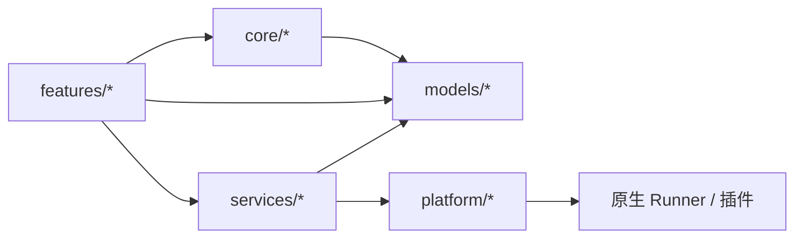

# 07 · 依赖关系

## 7.1 运行时依赖（`pubspec.yaml`）

| 依赖 | 版本 | 用途 |
|---|---|---|
| `focubili_android` | path | Android 插件：Cookie、订阅通知 |
| `focubili_apple` | path | iOS/macOS 插件：Cookie、通知、PiP、调度 |
| `archive` | ^4.0.9 | 设置/收藏备份 ZIP |
| `flutter_cache_manager` | ^3.4.1 | 图片/网络资源缓存 |
| `crypto` | ^3.0.7 | WBI MD5、缓存键 |
| `desktop_webview_window` | path（third_party） | Windows WebView2 登录（已修复导航时序） |
| `ffi` | ^2.1.4 | 原生 FFI（Linux/桌面） |
| `file_picker` | ^11.0.2 | 导入/导出文件选择 |
| `flutter_secure_storage` | ^10.3.1 | Windows/Linux Cookie 加密存储 |
| `flutter_local_notifications` | ^22.2.0 | Windows Toast / Linux 通知 |
| `flutter_localizations` | SDK | 中文 Material 文案 |
| `package_info_plus` | ^8.3.1 | 版本/包信息 |
| `path_provider` | ^2.1.6 | 应用目录 |
| `photo_view` | ^0.15.0 | 截图缩放/平移 |
| `qr_flutter` | ^4.1.0 | 桌面扫码登录 |
| `share_plus` | ^11.1.0 | 文本/文件分享 |
| `media_kit` | ^1.2.6 | 桌面/Apple 播放核心 |
| `media_kit_libs_windows_video` / `ios` / `macos` / `linux` | ^1.0.11 / ^1.1.4 / ^1.2.1 | libmpv / Apple 媒体库 |
| `media_kit_video` | path（third_party） | 补丁版视频纹理组件 |
| `shared_preferences` | ^2.5.5 | JSON 偏好存储 |
| `sqflite` | ^2.4.2 | 订阅原子快照 |
| `workmanager` | path（third_party） | Android 后台订阅 |
| `timezone` | ^0.11.1 | 定时/提醒 |
| `url_launcher` | ^6.3.2 | 外部链接 |
| `volume_controller` | ^3.6.0 | 系统音量 |
| `webview_flutter` / `webview_flutter_android` | ^4.14.1 / ^4.13.0 | Android/iOS 官方登录 WebView |
| `window_manager` | ^0.5.2 | 桌面窗口最小尺寸/居中 |
| `dbus` | ^0.7.14 | Linux 系统集成 |

`dev_dependencies`：`shared_preferences_platform_interface`（注入写失败）、`webview_flutter_platform_interface`（登录页替身）、`integration_test`、`flutter_test`、`msix`（Windows 安装包）、`flutter_lints`。

## 7.2 仓库内补丁依赖

| 目录 | 名称 | 补丁原因 |
|---|---|---|
| [third_party/desktop_webview_window](../../third_party/desktop_webview_window) | `desktop_webview_window` 0.3.0+focubili.1 | Windows 登录导航不中断；避免桌面 WebView 抢焦点 |
| [third_party/media_kit_video](../../third_party/media_kit_video) | `media_kit_video` 2.0.1 | 视频纹理/表面行为修正，配合桌面播放 |
| [third_party/workmanager](../../third_party/workmanager) | `workmanager` 0.10.10 | Android-only 后台订阅入口，与 headless engine 接线 |

这三个包通过 `path:` 引用，不使用 pub 版本；升级时需同步检查补丁内容。

## 7.3 原生依赖

| 平台 | 依赖 |
|---|---|
| Android | Media3 1.10.1（ExoPlayer/DASH）、AndroidX Core、WorkManager、Kotlin/AGP 8.11.1、compileSdk 36、NDK 28.2.13676358 |
| Apple | AVKit/AVFoundation（PiP）、BackgroundTasks（BGAppRefresh）、WebKit（WKWebView）、media_kit Apple libs |
| Windows | libmpv（media_kit_libs_windows_video）、WebView2（desktop_webview_window）、Win32/ATL、Inno Setup 6（安装器） |
| Linux | GTK、libmpv、dbus、CMake 构建链 |

## 7.4 内部模块依赖方向

补充规则：

- `features/player` 只依赖播放相关服务接口（`PlaybackService`、`PlayerOverlayService`、`PlayerRouteSession` 等），不直接调用原生通道。
- `services` 不得导入 `features`；需要回调时由根组件或页面注入函数（如订阅通知回调）。
- `models` 不依赖 `services`/`platform`，保持可纯 Dart 测试。
- `platform` 只依赖 `services` 的具体实现与能力枚举，是唯一的“装配点”。

## 7.5 服务之间的关键依赖

| 服务 | 依赖 | 说明 |
|---|---|---|
| `BilibiliVideoInfoService` | `BilibiliWbiSigningService`、`BilibiliRequestPolicy` | 搜索/详情签名与请求头 |
| `BilibiliHttpPublicContentService` | `BilibiliWbiSigningService`、`BilibiliCookieStore` | 公开内容 + 风控时会话 |
| `BilibiliInteractionService` | `BilibiliAuthService`、`BilibiliRequestPolicy` | 写操作复用已验证会话 |
| `OfflineDownloadQueue` | `OfflineVideoService`、`DownloadNotificationService` | 队列持久化 + 通知 |
| `PlaybackSourceResolver` | `OfflineVideoService` | 只解析已完成本地文件 |
| `CachedPlayerOverlayService` | `PlayerOverlayService`、`SubtitleMemoryCache`、`CacheLifecycle` | 代次缓存与失效 |
| `SubscriptionService` | `SubscriptionSnapshotStore`、`NativeSubscriptionScheduler`、`SubscriptionNotificationService` | 快照 + 调度 + 通知 |
| `ImageResourceCache` | `CacheLifecycle` | 账号/字幕失效栅栏 |
| `FocusTimerController` | `FocusSessionService`、`FocusNotificationService`、`AppBehaviorPreferencesService` | 状态持久化 + 通知 + 行为开关 |
| `PlatformServices` | 全部播放/缓存/Cookie/通知实现 | 唯一装配入口 |

## 7.6 升级与兼容注意

1. `package_info_plus` 锁 8.3.1、`share_plus` 锁 11.x：更高版本要求 AGP 8.12.1/Kotlin 2.2，当前 AGP 为 8.11.1。
2. Media3 统一 1.10.1，不要单独升级某个 `media3-*` 模块。
3. `flutter_secure_storage` 在 Linux 需要 libsecret；无可用密钥环时 Cookie 保存会失败并给出提示。
4. 修改 `third_party/media_kit_video` 后需同时验证 Windows/Linux/macOS 视频纹理。
5. 新增平台时先扩展 `AppPlatform` 与 `PlatformCapabilities`，再在 `PlatformServices` 装配，最后补原生 Runner。

下一章：[08-build-run-test.md](08-build-run-test.md) → 构建、运行与测试。
